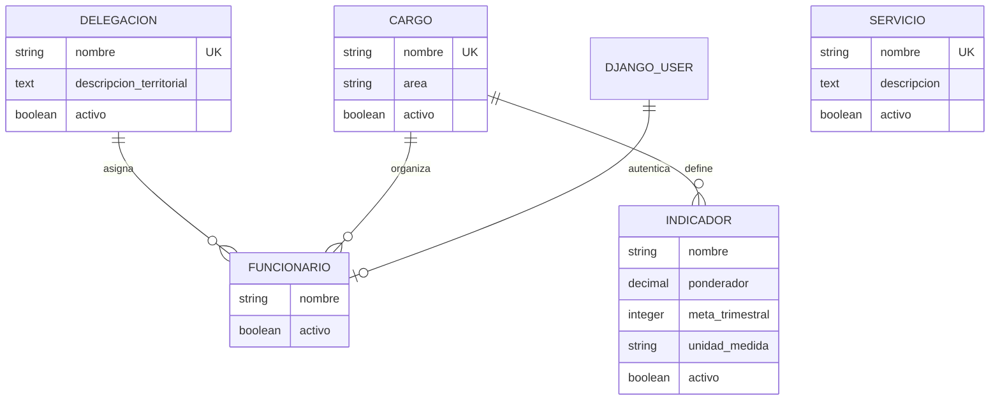
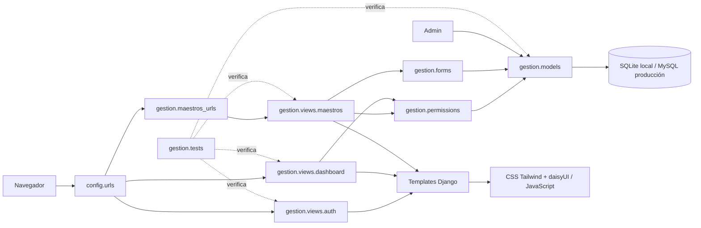
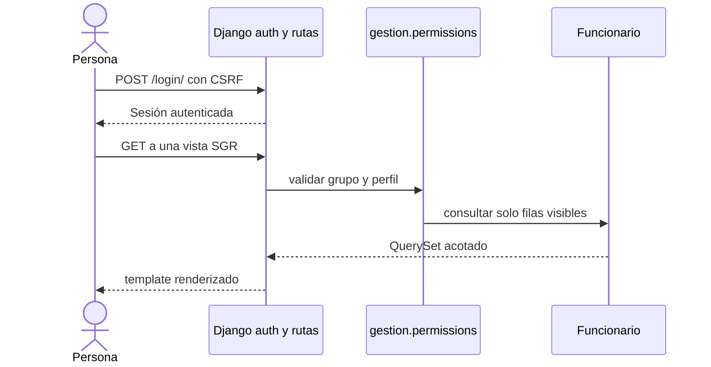
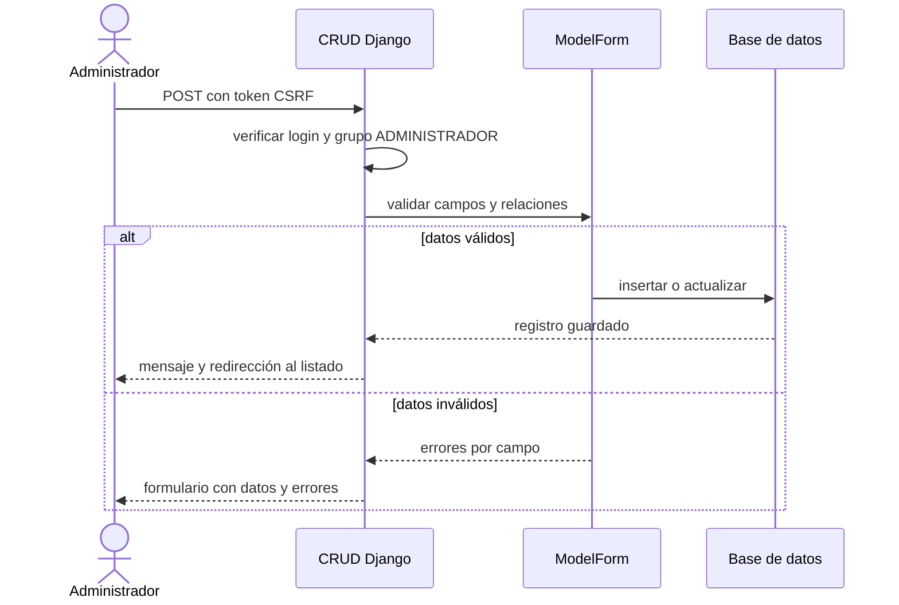
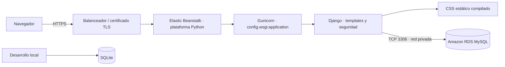

# Arquitectura 4+1 — SGR La Serena

## Escenarios (+1)

1. **Administrar catálogos:** una persona administradora inicia sesión, crea o modifica delegaciones, cargos, funcionarios, indicadores y servicios, y desactiva registros conservando sus relaciones.
2. **Consultar una delegación:** el delegado revisa el dashboard y las fichas del equipo asignado a su delegación.
3. **Consultar la ficha propia:** el funcionario ve su ficha y las pantallas de ejemplo; cambiar el ID de una URL no amplía su alcance.
4. **Revisar indicadores y compromisos:** los perfiles autorizados consultan semáforo, agenda y resumen. Sus valores están marcados como demostración y no admiten escritura transaccional.

## Vista lógica

La app `gestion` contiene cinco modelos maestros persistentes. `Funcionario` enlaza un usuario Django con un cargo y una delegación; `Indicador` pertenece a un cargo; `Servicio` mantiene su descripción y estado. `Cargo`, `Delegacion` e `Indicador` son protegidos frente a borrado físico cuando hay referencias. La baja se expresa mediante `activo=False`.

`SERVICIO` no se conecta con las demás entidades en el modelo actual. `DJANGO_USER` es el usuario configurado por Django; no es una tabla propia de la app.

## Vista de desarrollo: componentes y paquetes

Paquetes presentes: `config` para settings, URL raíz y WSGI; `gestion.models`, `forms`, `permissions`, `views`, `templates`, `static`, `management.commands` y `tests`; `pagina_muni/css/input.css` y `package.json` para compilar la hoja de estilos. Las rutas `maestros:*` se montan desde `config.urls`; las rutas de operación usan `gestion:*`.

## Vista de procesos

### Acceso

### Mantención de catálogo

Las rutas demostrativas solo admiten GET; las escrituras de actividades y compromisos quedan fuera de esta etapa.

## Vista física: despliegue

El diagrama representa el destino propuesto, no infraestructura existente. El acceso público queda en el balanceador con HTTPS. RDS debe permanecer sin acceso público y permitir conexión desde el grupo de seguridad de la aplicación. GitHub Pages conserva el sitio estático actual; no forma parte del camino de ejecución de Django.

## Resumen de las cinco vistas

| Vista | Contenido en este proyecto |
|---|---|
| Escenarios (+1) | Flujos de administrador, delegado y funcionario descritos arriba. |
| Lógica | Relaciones y restricciones entre usuario, funcionario, cargo, delegación, indicador y servicio. |
| Desarrollo | Paquetes Django, templates, static, build de CSS, migraciones y pruebas. |
| Procesos | Autenticación y autorización; validación, persistencia y baja lógica; páginas GET demostrativas. |
| Física | Navegador → Elastic Beanstalk/Django → RDS MySQL; SQLite para desarrollo local. |

El diagrama de componentes/paquetes describe los módulos de código; el diagrama de despliegue describe los nodos de ejecución solicitados por la pauta.
